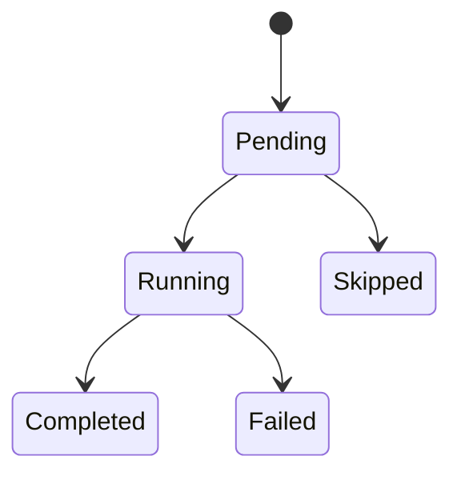

# Steps

A Step is an atomic unit of work within a Run. Each step is persisted in the database with its input, output, status, cost, duration, and token counts.

## Step kinds

| Kind | Method | Description |
|------|--------|-------------|
| Shell | `ctx.shell()` | Execute a shell command |
| Http | `ctx.http()` | Make an HTTP request |
| Agent | `ctx.agent()` | Call an AI agent (Claude, OpenAI, etc.) |
| Approval | `ctx.approval()` | Pause for human approval |
| HumanInput | `ctx.human_input()` | Pause until a human submits a typed answer ([Human Input](human-input.md)) |
| Signal | `ctx.wait_for_signal()` | Pause until an external signal arrives or a timeout elapses ([Signals](signals.md)) |
| Decision | `ctx.decision()` | Make a typed machine decision ([System One / Jev](decision.md)) |
| Workflow | `ctx.workflow()` | Start a sub-workflow |
| Custom | `ctx.operation()` | Run a custom [Operation](operations.md) |

## Shell steps

```rust,ignore
let output = ctx.shell("build", ShellConfig::new("cargo build")).await?;
if output.is_success() {
    // continue
}
```

`ShellConfig::new` hands its string to `sh -c`: pipes, redirects and globs work, and
so would a quote or a `;` smuggled into it. When the command carries data the workflow
does not control (its input, a webhook payload, a human answer, an agent output), use
`ShellConfig::exec`, which spawns the program directly and passes each argument as is:

```rust,ignore
let input: GreetInput = ctx.input().await?;
ctx.shell("greet", ShellConfig::exec("printf", &["Hello, %s!\n", &input.name])).await?;
```

The step's `command` holds the program and its `args` the arguments; `timeout_secs`,
`dir`, `env`, `exit_code_as_output` and artifacts work the same in both modes.

## HTTP steps

```rust,ignore
let response = ctx.http("fetch-data", HttpConfig::get("https://api.example.com/data")).await?;
```

An HTTP step refuses a host that is, or resolves to, a private, loopback, link-local or
cloud metadata address (`localhost`, `10.0.0.5`, a Kubernetes service name,
`169.254.169.254`). Allow an internal service with `.allow_host("billing.internal")`, or
for the whole deployment with the worker's `IRONFLOW_HTTP_ALLOWED_HOSTS`
(comma-separated).

A shell step reads back through `stdout()`, `stderr()` and `exit_code()`, an
HTTP step through `status()` and `body()`. A step tolerated with
`allow_failure()` that failed reads back its message through `error()`. When the
run resumes, for instance after a signal, a tolerated failure is replayed with the
same `{"error": ...}` output and the step is not executed again. Files a shell step declares with
`.output("target/*.log")` are handed to later steps through a handle:
`build.artifact("build.log")?`, passed to `ShellConfig::input(&handle)` or
`ctx.get_artifact(&handle)`. A name the step did not declare fails with
`EngineError::ArtifactNotDeclared`.

## Agent steps

```rust,ignore
let result = ctx.agent("analyze", AgentStepConfig::new("Analyze this log file")).await?;
println!("{}", result.text());

#[derive(Deserialize, JsonSchema)]
struct Verdict { approved: bool }

// With `.output::<T>()` the step returns the `T` itself.
let verdict = ctx
    .agent("review", AgentStepConfig::new("Review the diff").max_turns(2).output::<Verdict>())
    .await?;
```

To read the `environment_id` or `account_id` of a typed step as well, call
`ctx.agent_with_meta(..)`: it returns an `AgentReply` with the typed `answer` next to them.

`.effort(Effort::High)` sets the reasoning effort (`low`, `medium`, `high`, `xhigh`, `max`).
It is passed as `--effort` to the Claude CLI providers and as `output_config.effort` to the
Anthropic API provider; other HTTP providers ignore it. Without it no flag is sent and the
model default applies.

Tools are an enum: `.allow_tool(Tool::Bash)`, `Tool::Custom("mcp__server__tool".into())`
for anything else. `.available_tools([Tool::Read])` bounds the built-in tools the Claude CLI
offers (`--tools`), where `allow_tool` only pre-approves. A step can have tools and structured output: with
`.allow_tool(Tool::Read).output::<Verdict>()` the agent reads what it needs, then
`ctx.agent` returns the `Verdict`. Claude Code fills the structured answer with tools
active (tested with 2.1.296 and 2.1.304); count one more turn in `max_turns` per round
of tool calls.

On an HTTP provider, tools are registered on the worker in named profiles
(`HttpAgentProvider::with_tool_profile`). Each profile is a `ToolProfile` constant,
`const BUG: ToolProfile = ToolProfile::new("bug");`, shared by the worker and the
handlers, so a misspelled profile does not compile. A step picks one with
`.tool_profile(BUG)` and sees only its tools; without a profile it gets the `with_tools` registry, or none.
An unknown profile fails the step, a Claude CLI provider refuses any profile, and the
run logs name the profile with the tools it exposed.

With [Provider Accounts](provider-accounts.md), `.account("perso-max")` pins a step to one
account and `.account_pool("team")` to the accounts carrying a tag. When none of them has
capacity, the run sleeps until the next reset and the step runs again from the start, up to
`.max_capacity_wait(..)` (6 hours by default, `.fail_fast_on_capacity()` fails fast); see
[When every account is limited](provider-accounts.md#when-every-account-is-limited).

### Reusable agent roles

An agent used by several workflows (a reviewer, a triager) is defined once with
`impl AgentRole`, then called with a task:

```rust,ignore
struct Reviewer;

impl AgentRole for Reviewer {
    type Input = String;
    type Output = Verdict;

    fn prompt(&self, diff: String) -> String {
        Prompt::new().text("Review this diff:").untrusted(&diff).to_string()
    }

    fn append_system_prompt(&self) -> Option<&str> {
        Some("You are a strict reviewer.")
    }

    fn tools(&self) -> Vec<Tool> {
        vec![Tool::Read]
    }

    fn max_turns(&self) -> Option<u32> {
        Some(4)
    }
}

let verdict: Verdict = ctx
    .agent("review", Reviewer.task(diff).max_budget_usd(0.25))
    .await?;
```

Only `prompt` is required. The persona, tools, permission mode, MCP config and output type
are locked by the role: the task has no setter for them, so a call that widens the rights
does not compile (a role with more rights is another role). The model, budget, `max_turns`,
effort and per-call settings (`working_dir`, `allow_failure`, `retry_policy`, pod labels,
resume settings) are defaults the caller may override.

The step is stored and replayed like any `AgentStepConfig` step. An override changes the
step config, so it changes the hash of a `RecordReplayProvider` fixture: a fixture recorded
for the role defaults does not match an overridden task.

For a role with tools, put the persona in `append_system_prompt`: `system_prompt` replaces
the Claude Code prompt, which carries the tool and skill instructions. A structured output
needs at least 2 turns.

### Untrusted content in a prompt

Text the workflow did not write (an issue, a review comment, a diff, a CI log, a webhook
payload) can carry instructions aimed at the agent. Build the prompt with `Prompt`
instead of `format!`:

```rust,ignore
use ironflow_engine::config::{AgentStepConfig, Prompt};

let prompt = Prompt::new()
    .text("Propose labels for this issue:")
    .untrusted(&issue.body)
    .text("Answer with the labels only.");
let labels = ctx
    .agent("propose-labels", AgentStepConfig::new(&prompt.to_string()))
    .await?;
```

Each `untrusted(..)` part lands in a block whose tags carry a nonce drawn for the prompt,
`<untrusted nonce="...">` ... `</untrusted nonce="...">`. Inside the content, every `<`
followed by the tag name, in any ASCII case and after any run of whitespace and `/`, becomes
`&lt;`, so a literal forged tag neither closes the block nor opens another one. Look-alikes
the escaping does not catch (a full-width less-than sign, a zero-width character in the
name) cannot carry the nonce, which the content's author never sees. When the prompt holds a block, it
opens with `DEFAULT_UNTRUSTED_INSTRUCTION`, which tells the agent to treat the blocks as
data; `.instruction(..)` replaces that text. `Prompt` lives in `ironflow_core::prompt` and
works in library mode too (`Agent::new().prompt(&prompt.to_string())`).

`RecordReplayProvider` masks the nonce when it names a fixture: the same prompt finds its
fixture from one run to the next.

## Sub-workflow steps

A child declares its input type with `TypedWorkflow` and the parent passes that
type; see [WorkflowHandler](workflow-handler.md#typed-input-for-sub-workflows).

```rust,ignore
let child = ctx.workflow(&Collect, CollectInput { host: "db-1".into() }).await?;
println!("child run {}", child.run_id());
```

### Reading the child output

A child publishes a typed result with `ctx.set_output(&value)` (see
[Run output](workflow-handler.md#run-output)); the parent reads it back with
`child.output::<T>()`:

```rust,ignore
#[derive(Serialize, Deserialize)]
struct Verdict {
    approved: bool,
}

let child = ctx.workflow(&Review, ReviewInput { mr: input.mr }).await?;
match child.output::<Verdict>()? {
    Some(verdict) if verdict.approved => println!("approved"),
    Some(_) => println!("changes requested"),
    None => println!("the reviewer gave no verdict"),
}
```

- `Ok(None)` when the child set no output.
- `Err(EngineError::Serialization)` when the output does not deserialize into `T`.
- The output is recorded in the parent's `Workflow` step: a resumed parent reads
  the same value, without reading the child run again.
- A child tolerated with `allow_failure` keeps the output it set before failing.

### Exclusive children

`ctx.workflow_with` takes `WorkflowOptions`. With a concurrency key, the child is
created only if no non-terminal run holds the same key; otherwise no child is
created and the step completes with the run that holds it:

```rust,ignore
let options = WorkflowOptions::new().concurrency_key(format!("issue:{}", input.issue));
match ctx.workflow_with(&FixIssue, FixInput { issue: input.issue }, options).await? {
    SubWorkflowOutcome::Completed(child) => println!("fixed in run {}", child.run_id()),
    SubWorkflowOutcome::Conflict(conflict) => {
        println!("issue already handled by run {}", conflict.run_id());
    }
}
```

The conflict is recorded as the step output (`{"concurrency_conflict": {"key", "run_id"}}`)
and replayed as-is when the parent resumes, even if the key was released in between: the
branch taken by the handler stays stable. `ctx.workflow` and `ctx.workflow_dyn` set no
key and keep returning the child output directly.

To tolerate a failed child, use `ctx.workflow_with(&Collect, input, WorkflowOptions::new().allow_failure())`:
the child run is still marked failed, but the step completes with a `Completed` outcome whose `status()` is `Failed`
(or `Cancelled`) and `child.error()` carrying the message, and the parent ends as `Warning`.
A suspension is never tolerated. A resume replays the step and creates no new child.

```rust,ignore
let outcome = ctx
    .workflow_with(&Collect, CollectInput { host: "db-1".into() }, WorkflowOptions::new().allow_failure())
    .await?;
if let Some(child) = outcome.output().filter(|c| c.status() == RunStatus::Failed) {
    println!("collect failed: {:?}", child.error());
}
```

### Step names and labels

`WorkflowOptions` names the parent's step and labels the child run:

```rust,ignore
let options = WorkflowOptions::new()
    .step_name(format!("delegate-{tour}-{agent}"))
    .label("team.example/tour", tour.to_string())
    .label("team.example/agent", agent.as_str());
ctx.workflow_with(&Delegate, DelegateInput { agent: agent.clone() }, options).await?;
```

- The step is named after the child handler by default. The name identifies the step in
  the run timeline and on resume: a handler that delegates to the same child several times
  gives each call its own name. An empty or blank name panics.
- The child inherits the labels of its parent run; a label set here replaces an inherited
  one with the same key. `ironflow.io/*` keys are set by the engine
  (`ironflow.io/parent-run-id`, `ironflow.io/root-run-id`) and panic.

### Children in parallel

`ctx.workflows_with(&Child, children)` takes one `(input, WorkflowOptions)` per child and
runs the whole wave concurrently, with a `Workflow` step per child at the same position.
The cost cap of the root holds for the whole wave. See
[Parallel Execution](../guides/parallel-execution.md#sub-workflows-in-parallel).

### Suspension of a child

A child may suspend like any run: an approval, a human input, a signal wait or
a delay. The whole chain is then suspended, durably:

- the child run keeps its own status (`AwaitingApproval` or `Sleeping`) and
  owns the wake-up (`scheduled_at` of a delay or a signal deadline);
- the parent's `Workflow` step stays `Running` and records the child run id;
- the parent, and every ancestor up to the root, takes the same status without
  any `scheduled_at`.

The child run carries two labels, `ironflow.io/parent-run-id` and
`ironflow.io/root-run-id`, so it can be listed and resolved like a top-level
run: answer its human input, approve its gate or send it a signal through the
usual API routes. Resuming the child resumes the root run: it replays its
completed steps (a child that already completed is not run again) and
re-enters the same child run, which picks up where it stopped. Rejecting an
approval gate inside the child fails the child and every ancestor.

Several children of a `workflows_with` wave may be suspended at once. Each one
publishes its own event (approval requested, signal awaited) and resumes the
root on its own. A child resolved while a sibling already resumed the root waits
for the root to stop, then resumes it again unless the root re-entered it in the
meantime: the root never runs twice at once and no child is failed for it.

### Cancellation and stopped parents

A child only runs inside its parent's execution, so no child outlives its
parent:

- `POST /api/v1/runs/:id/cancel` cancels the run and every sub-workflow run
  below it that has not finished. Their open steps are closed and their
  concurrency keys released; the response lists them in
  `cancelled_descendants`. `GET /api/v1/runs/:id` gives the count beforehand
  in `active_descendant_count`.
- A parent that fails, schedules a retry (a timeout, a panic, a handler error)
  or runs out of lease recoveries cancels the children its attempt left
  running. A retry starts new children.
- Cancelling a child directly ends the parent's `Workflow` step with the
  child's `Cancelled` status. A suspended chain is woken for it. Without
  `allow_failure` the step and the parent fail with `ChildRunCancelled`, never
  retried; with it the step completes with a `Cancelled` output and the parent
  ends as `Warning`.
- Pausing a root run pauses its children with it, and resuming it resumes
  them. A child is never paused or resumed on its own (see
  [Pausing runs and workflows](engine-worker.md#pausing-runs-and-workflows)).

## Approval steps

```rust,ignore
ctx.approval("prod-gate", ApprovalConfig::new("Deploy to production?")).await?;
```

The run suspends on `AwaitingApproval` until a human answers. A gate can also
carry an SLA: a deadline persisted on the step and an escalation policy applied
when it expires.

```rust,ignore
use std::time::Duration;

ctx.approval(
    "prod-gate",
    ApprovalConfig::new("Deploy to production?")
        .assigned_to(Assignee::group("release-managers"))
        .with_deadline(Duration::from_secs(3600))
        .on_timeout(EscalationPolicy::AutoReject),
).await?;
```

| Field | Builder | Meaning |
|-------|---------|---------|
| `message` | `ApprovalConfig::new` | Prompt shown to reviewers |
| `assignee` | `assigned_to` | `Assignee::user` / `Assignee::group` expected to answer |
| `deadline_secs` | `with_deadline` / `with_deadline_secs` | SLA window, in seconds |
| `on_timeout` | `on_timeout` | `EscalationPolicy` applied when the deadline fires (defaults to `AutoReject`) |
| `timeout_seconds` | `with_timeout_seconds` | Legacy spelling of a deadline with an implicit `AutoReject` |
| `approvers` | `requiring` | `Approvers` computed by the handler: required approvals, allowed groups and an audit reason |

See [Approval Gates](approval-gates.md) for the full list of escalation policies,
where the remaining time surfaces, and how to
[require several approvers](approval-gates.md#requiring-several-approvers).

## Human input steps

```rust,ignore
#[derive(Deserialize, JsonSchema)]
struct Answers {
    answers: Vec<String>,
}

let answers: Answers = ctx
    .human_input("clarify", HumanInputConfig::new("Answer the clarification questions"))
    .await?;
```

The run suspends on `AwaitingApproval` until a person posts an answer matching
the JSON schema of `Answers` to `POST /api/v1/runs/:id/steps/:step_id/input`.
The config takes the same deadline, escalation, assignee and approvers options
as an approval gate. A rejected input reaches the handler as
`EngineError::HumanInputRejected`. See [Human Input](human-input.md).

## Decision steps

A decision step asks a [`DecisionProvider`](decision.md) (System One / Jev) the
questions declared by a struct and returns that struct, filled with the answers.

```rust,ignore
#[derive(DecisionChoice)]
enum Team { Billing, Technical }

#[derive(DecisionAnswers)]
struct Routing {
    #[choice("Which team?")]
    team: Team,
}

let routing = ctx.decision(
    "triage",
    DecisionConfig::new("Payouts have been failing for 3 days")
        .answers::<Routing>()
        .escalate_below(0.7),
).await?;
if let Team::Billing = routing.team { /* .. */ }
```

Below the `escalate_below` confidence threshold, the run suspends for human approval;
on resume the stored answers are replayed as-is. See [Decisions](decision.md).

## Conditions

A handler branches with plain Rust `if`/`else`. That is invisible to the
[execution planner](../guides/execution-plan.md), which is why two helpers
exist to declare a branch explicitly.

`ctx.when(label, predicate)` deserializes the run input into the type the
closure takes and evaluates the predicate on it. It returns the predicate's
value, and the planner records it as `evaluated` together with the label you
gave the branch. The label is a name for the operator, never parsed:

```rust,ignore
#[derive(Deserialize, PartialEq)]
#[serde(rename_all = "lowercase")]
enum Env { Prod, Staging }

#[derive(Deserialize)]
struct DeployInput { env: Env }

if ctx.when("production run", |i: &DeployInput| i.env == Env::Prod).await? {
    ctx.shell("deploy-prod", ShellConfig::new("./deploy prod")).await?;
} else {
    ctx.skip("deploy-prod", "not a production run").await?;
}
```

A payload that does not match the type (`"env": "prd"`) fails with
`EngineError::Serialization` instead of silently taking the `else` branch.

`ctx.when_dynamic(label, value)` declares a branch whose value comes from
a previous step's output. It returns `value` unchanged; the planner records the
condition as `unevaluable`, because step outputs are synthetic while planning:

```rust,ignore
let build = ctx.shell("build", ShellConfig::new("cargo build")).await?;
if ctx.when_dynamic("build succeeded", build.is_success()) {
    ctx.shell("deploy", ShellConfig::new("./deploy")).await?;
}
```

Both helpers are optional: a plain `if` still runs exactly the same way. They
only make the branch legible to whoever reads the plan.

## Step status lifecycle

Steps follow this state machine:



Every step transition is recorded. Failed steps report their error in the step output.
